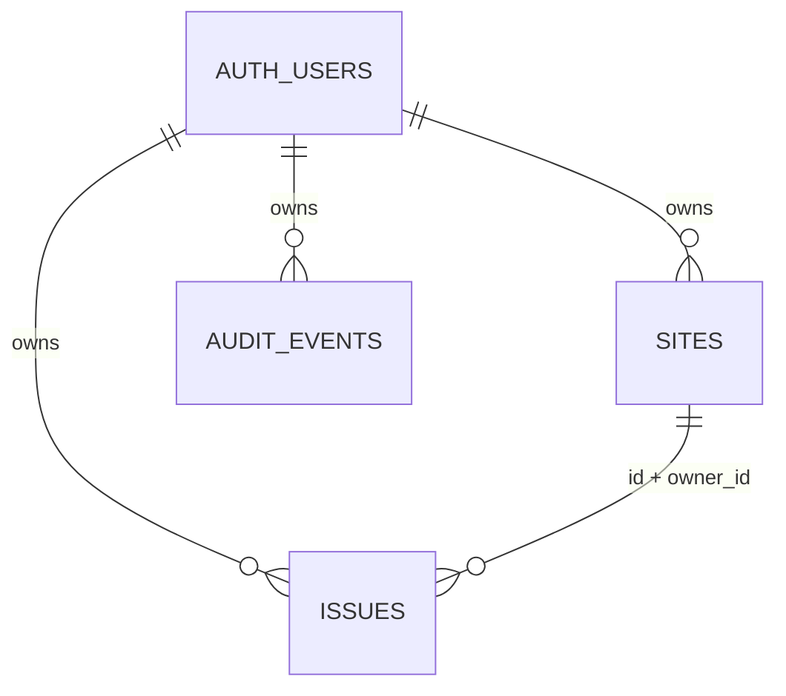

# 設計

`app` はルーティングとサーバー側の本人確認、`components` は画面・フォーム、`lib` は検証・型・DB接続、`supabase/migrations` はスキーマ・アクセス制御を管理します。

App Routerのトップ画面はSupabase `getUser()` で本人を検証し、未認証ならログインへ遷移します。SSR用Cookieはproxyが更新します。ブラウザー操作にも各リクエストでJWTが付き、最終的な認可はDBのRLSが行います。フロントの表示制限だけに依存しません。

確認事項はサイトに所属し、重要度（critical/high/medium/low）、状態（open/in_progress/resolved）、改善内容と期限を持ちます。サイト削除の連鎖で確認事項を消さず、先に明示的な削除が必要です。履歴はDB変更と同じトランザクションで生成します。

本人だけの管理領域を採用しました。組織共有を追加する際は `organizations` / `memberships` と役割を設け、サイト・確認事項・履歴すべてのRLSを組織単位へ移行します。メンバー追加権限・退職者の除外・組織間分離を追加検証します。メールドメインだけでの自動共有は行いません。

自動診断を追加する場合は別のワーカー・ジョブテーブルを使い、対象の所有権確認と許可された範囲、SSRF対策、レート制御、結果の根拠を設計します。現在のURL入力からサーバーが対象サイトへアクセスする処理はありません。
